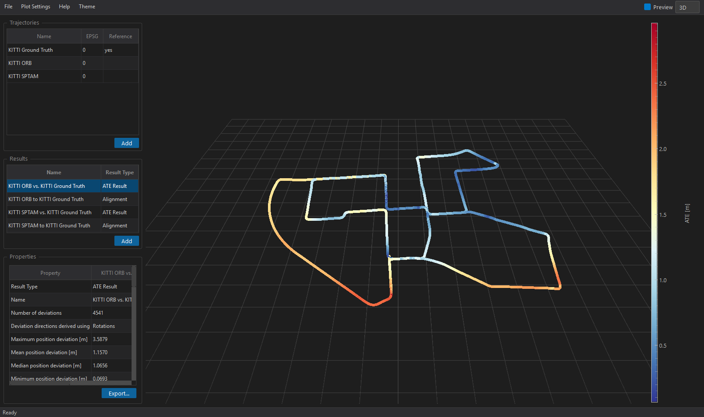

<div align="center">
    <h1>Trajectopy - Trajectory Evaluation in Python</h1>
    <a href="https://github.com/gereon-t/trajectopy/releases"></a>
    <a href="https://www.python.org/downloads/"></a>
    <a href="https://github.com/gereon-t/trajectopy/blob/main/LICENSE"></a>
    <a href="https://github.com/astral-sh/ruff"></a>

<h4>Trajectopy is a Python package with an optional graphical user interface for empirical trajectory evaluation.</h4>

<p align="center">
  
</p>

</div>

Trajectopy compares an estimated trajectory, e.g. from SLAM, visual odometry or GNSS/INS, with a reference
(ground truth). It aligns both in space and time, computes the absolute and relative trajectory error and shows
the deviations in plots, reports and Google Earth.

## Key Features

- **Alignment**: a spatio-temporal least squares alignment that estimates a similarity transformation, a time
  shift and a leverarm, each of them optional, weighted by the accuracies of both trajectories.
- **Evaluation**: absolute trajectory error (ATE) with along-track and cross-track components, relative pose
  error (RPE), percentiles, confidence intervals that account for the temporal correlation of the deviations,
  and summary tables and HTML reports to compare several estimates.
- **Data**: trajectopy, TUM, KITTI and EuRoC files, ASCII files with any column layout, time format and
  coordinate system (any EPSG code), and ROS1 and ROS2 bags.
- **Visualization**: fast, interactive plots (PNG, JPG or SVG export) and Google Earth export.
- **GUI**: everything above without writing code, plus an interactive alignment for cases in which an automatic
  alignment fails.

## Quick Start

```console
pip install "trajectopy[gui]"
```

Compute the absolute and relative trajectory error of an estimate. The example files are in the
[`example_data`](https://github.com/gereon-t/trajectopy/tree/main/example_data) folder of the repository.

```python
import trajectopy as tpy

reference = tpy.Trajectory.from_file("./example_data/KITTI_gt.traj")
estimate = tpy.Trajectory.from_file("./example_data/KITTI_ORB.traj")

# ATE: the estimate is aligned to the reference first
ate_result = tpy.ate(estimate, reference)
print(ate_result)

# RPE: drift between poses 100 m to 800 m apart
rpe_result = tpy.rpe(estimate, reference)
print(rpe_result)
```

Or start the GUI with `trajectopy`, drop both files onto the trajectory table, right-click the reference and
choose *Set as Reference*, then right-click the estimate and choose *Compare with Reference*.

## Documentation

<div class="grid cards" markdown>

- **[Installation](installation.md)**

    Python package, extras and the Windows app.

- **[User Guide](user_guide/index.md)**

    Trajectories, alignment, evaluation, plots, file formats, settings, the GUI and the command line.

- **[API Reference](api/index.md)**

    Every public class and function with its parameters.

- **[Release Notes](release_notes.md)**

    What changed in each version, and how to migrate.

</div>

## Citation

If you use Trajectopy for academic work, please cite our
[paper](https://www.degruyter.com/document/doi/10.1515/jag-2024-0040/html):

```bibtex
@article{Tombrink2024,
  title = {Spatio-temporal trajectory alignment for trajectory evaluation},
  author = {Gereon Tombrink and Ansgar Dreier and Lasse Klingbeil and Heiner Kuhlmann},
  journal = {Journal of Applied Geodesy},
  year = {2024},
  doi = {10.1515/jag-2024-0040},
  url = {https://doi.org/10.1515/jag-2024-0040},
  codeurl = {https://github.com/gereon-t/trajectopy}
}
```

## License and Contributing

Trajectopy is released under the GNU General Public License v3.0. Bug reports and contributions are welcome on
[GitHub](https://github.com/gereon-t/trajectopy); please add the output of `trajectopy.show_versions()` to bug
reports.

---

*Developed at the Institute of Geodesy and Geoinformation, University of Bonn*
