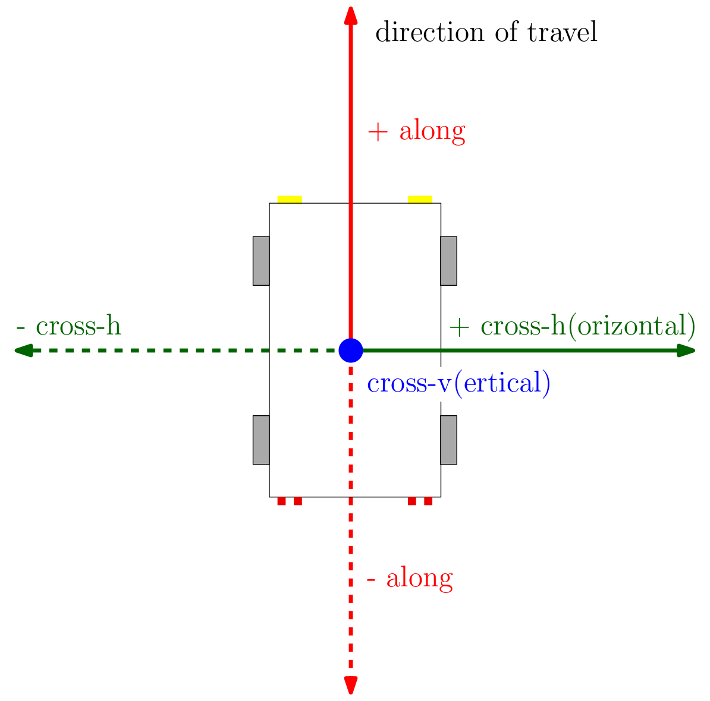

# Settings

Trajectopy has two kinds of settings:

- **Processing settings** (`ProcessingSettings`): how trajectories are aligned, matched, compared, smoothed
  and sorted. In the GUI, every trajectory has its own (*Settings…* in its context menu).
- **Plot settings** (`PlotSettings`): how results are plotted. In the GUI, they apply to all plots
  (*Plot Settings* in the menu bar).

Both can be created in Python, changed attribute by attribute, and saved to or loaded from JSON files:

```python
import trajectopy as tpy

settings = tpy.ProcessingSettings()
settings.alignment.estimation_settings.time_shift = True
settings.matching.method = tpy.MatchingMethod.NEAREST_TEMPORAL
settings.to_file("settings.json")

settings = tpy.ProcessingSettings.from_file("settings.json")
plot_settings = tpy.PlotSettings(ate_unit_is_mm=True, line_width=2)
```

In a JSON file, the settings are nested like the attributes; options are written as lower-case strings
(e.g. `"method": "nearest_temporal"`). Settings missing in a file keep their default values, and unknown settings
are ignored with a warning, so that files of other trajectopy versions can be read. In a file, a value of the
wrong type or an unknown option raises a `TypeError`. Options can also be given as strings in Python, e.g.
`tpy.MatchingSettings(method="nearest_temporal")`; an unknown option raises a `ValueError` there.

Every processing function takes either its own part of the settings (e.g. `MatchingSettings` for
`match_trajectories`) or the complete `ProcessingSettings`. Functions that need several parts use the defaults
for the parts they are not given: `estimate_alignment` and `align` with `AlignmentSettings`, and `rpe` with
`RelativeComparisonSettings`, use the default matching settings. `ate` needs both matching and alignment and
takes only `ProcessingSettings`.

## Processing Settings

| Attribute | Contents |
| :--- | :--- |
| `alignment` | Trajectory alignment: similarity transformation, time shift, leverarm |
| `matching` | Matching of corresponding poses of two trajectories |
| `relative_comparison` | Relative trajectory comparison (RPE) |
| `approximation` | Smoothing (approximation) of trajectories |
| `sorting` | Spatial sorting of trajectories |

### Alignment Settings

The alignment estimates the parameters that transform a trajectory onto a reference with a least squares
adjustment of matched poses. Its settings have four parts.

#### Preprocessing (`alignment.preprocessing`)

| Setting | Description | Default |
| --- | --- | --- |
| `min_speed` | Only poses with at least this speed (m/s) are used; `0` keeps standstills. | `0.0` |
| `time_start` | Only poses from this time on are used, in seconds relative to the first common timestamp of both trajectories. | `0.0` |
| `time_end` | Only poses up to this time are used, in seconds relative to the first common timestamp (`0` = until the end). | `0.0` |
| `max_samples` | Maximum number of matched poses used for the alignment. For larger trajectories, a new random subset of this size is drawn on each run, which keeps the least squares adjustment fast and memory-friendly (`0` = all poses). | `5000` |

#### Estimated Parameters (`alignment.estimation_settings`)

| Setting | Description | Default |
| --- | --- | --- |
| `translation_x`, `translation_y`, `translation_z` | Translation of the similarity transformation | `True` |
| `rotation_x`, `rotation_y`, `rotation_z` | Rotation of the similarity transformation | `True` |
| `scale` | Scale of the similarity transformation | `False` |
| `time_shift` | Time shift between both trajectories | `False` |
| `leverarm_x`, `leverarm_y`, `leverarm_z` | Leverarm between both trajectories (needs orientations) | `False` |
| `sensor_rotation` | Constant mounting rotation between both trajectories in the body frame (roll, pitch and yaw offsets). It is computed independently of the least squares adjustment. | `False` |

#### Stochastics (`alignment.stochastics`)

Standard deviations of the observations, which weight them in the least squares adjustment.

| Setting | Description | Default |
| --- | --- | --- |
| `std_xy_from`, `std_z_from` | Horizontal / vertical position of the trajectory to align (m) | `1.0` |
| `std_xy_to`, `std_z_to` | Horizontal / vertical position of the reference (m) | `1.0` |
| `std_roll_pitch` | Roll and pitch (rad); used only when the leverarm is estimated | `0.01745` (1°) |
| `std_yaw` | Yaw (rad); used only when the leverarm is estimated | `0.01745` (1°) |
| `std_speed` | Speed (m/s); used only when the time shift is estimated | `1.0` |
| `error_probability` | Error probability of the statistical tests | `0.05` |
| `variance_estimation` | Estimate the variance factor a posteriori | `False` |
| `robust_estimation` | Down-weight epochs with large residuals (iteratively reweighted least squares with Huber weights), so that outliers hardly affect the estimated parameters | `True` |
| `use_position_std` | Weight the positions by the standard deviations stored with the trajectories (covariances of ROS messages or the `sx`, `sy`, `sz` columns of a file) instead of the `std_*` values, for each trajectory that has them | `True` |

#### Convergence (`alignment`)

Usually, these can be left at their default values.

| Setting | Description | Default |
| --- | --- | --- |
| `metric_threshold` | Iteration threshold of the least squares adjustment for the metric parameters | `0.0001` |
| `time_threshold` | Iteration threshold of the least squares adjustment for the time shift (s) | `0.0001` |

### Matching Settings

Matching finds the corresponding poses of two trajectories, for the alignment and for the ATE.

| Setting | Description | Default |
| --- | --- | --- |
| `matching.method` | Matching method (`MatchingMethod`), see below | `interpolation` |
| `matching.max_time_diff` | Maximum time difference of poses matched by their timestamps (s; `0` = no limit) | `0.01` |
| `matching.max_distance` | Maximum distance of poses matched spatially (m; `0` = no limit) | `0.0` |
| `matching.max_gap_size` | Maximum gap within a trajectory that is bridged by interpolation (s, or m for spatially sorted trajectories; `interpolation` method) | `10.0` |
| `matching.k_nearest` | Number of nearest neighbors for `nearest_spatial_interpolated` | `2` |

#### Matching Methods

- **`interpolation`**: the poses of one trajectory are interpolated at the timestamps of the other. Positions are
  interpolated linearly, rotations with SLERP.
- **`nearest_temporal`**: each pose is matched with the pose of the other trajectory with the nearest timestamp
  (within `max_time_diff`).
- **`nearest_spatial`**: each pose is matched with the nearest position of the other trajectory (Euclidean distance,
  within `max_distance`). This needs no common time reference.
- **`nearest_spatial_interpolated`**: for each pose of the trajectory to evaluate, the `k_nearest` positions of the
  reference are requested and a 3D line is fitted through them; the pose is matched with its projection onto that
  line. The matched rotations are the chordal L2 mean of the neighbors' rotations. Poses with fewer than two
  reference positions within `max_distance` are left out.

### Relative Comparison Settings

| Setting | Description | Default |
| --- | --- | --- |
| `relative_comparison.pair_min_distance` | Smallest distance between the poses of a pair | `100.0` |
| `relative_comparison.pair_max_distance` | Largest distance between the poses of a pair | `800.0` |
| `relative_comparison.pair_distance_step` | Step between the pair distances | `100.0` |
| `relative_comparison.pair_distance_unit` | Unit of the pair distances (`PairDistanceUnit`): `meter` or `second` | `meter` |
| `relative_comparison.use_all_pose_pairs` | Use all (overlapping) pose pairs instead of consecutive (non-overlapping) ones | `True` |

The RPE is explained in [Evaluation](evaluation.md#relative-pose-error-rpe). With the default settings, pose
pairs are formed for the distances 100 m, 200 m, …, 800 m.

### Approximation Settings

The positions are approximated by piecewise cubic polynomials, the rotations by a moving average. For the
positions, the trajectory is divided into intervals; an interval is closed as soon as it is longer than
`position_interval_size` and contains at least `position_min_observations` poses (remaining poses extend the
last interval). The cubic polynomials of neighboring intervals share their values and first derivatives at the
interval borders, so that the approximation is smooth. With the defaults and data at 1 Hz, for example, the
intervals are about 25 s long, because of the minimum number of observations.

The interval and window sizes refer to the index of the trajectory: seconds for trajectories sorted by time,
meters for spatially sorted trajectories.

| Setting | Description | Default |
| --- | --- | --- |
| `approximation.position_approximation_method` | Method for the positions (`PositionApproximationMethod`): `cubic` | `cubic` |
| `approximation.position_interval_size` | Size of the intervals of the piece-wise cubic approximation | `0.15` |
| `approximation.position_min_observations` | Minimum number of observations per interval | `25` |
| `approximation.rotation_approximation_method` | Method for the rotations (`RotationApproximationMethod`): `average_in_window` (moving average, see `rotation_window_size`) or `average_per_path_length` (for trajectories that pass the same track several times: averages the rotations of all laps at the same path length, see `max_path_length_gap`) | `average_in_window` |
| `approximation.rotation_window_size` | Size of the moving average window for the rotations | `0.15` |
| `approximation.max_path_length_gap` | Maximum path length gap (m) that is bridged when the rotations of several laps are averaged | `0.15` |

### Sorting Settings

Sorting involves two steps:

1. Smoothing the trajectory using Moving Least Squares (MLS). For each point, the `k_nearest` nearest voxel
   centroids are searched, a 3D line is fitted through all points of these voxels, and the point is projected
   onto this line. This step reduces noise and outliers in the trajectory.
2. Reconstruction of the point order from a minimum spanning tree (MST) of the smoothed points. The tree is traversed depth-first from one end of its longest path, visiting short side branches (caused by noise) before continuing along the trajectory.

| Setting | Description | Default |
| --- | --- | --- |
| `sorting.voxel_size` | Size of the voxel grid (m). Instead of the raw points, the centroids of the occupied voxels are used for the nearest neighbor searches of the MLS. | `0.05` |
| `sorting.movement_threshold` | The MLS iterations stop when the points move less than this on average (m), after at most 10 iterations. | `0.005` |
| `sorting.k_nearest` | Number of nearest voxels used by the MLS | `4` |

## Plot Settings

All plots, in the GUI and in `trajectopy.visualization`, use the same `PlotSettings`:

| Setting | Description | Default |
| --- | --- | --- |
| `ate_unit_is_mm` | Show position deviations in millimeters instead of meters | `False` |
| `directed_ate` | Split position deviations into along-track, horizontal cross-track and vertical cross-track instead of x, y and z (see below) | `False` |
| `ate_remove_above` | Exclude position deviations above this value (m) from the plots (`0` = keep all). Applied by `visualization.deviation_figures`, i.e. in the plots of the GUI, reports and `--figures`; the functions for single figures ignore it | `0.0` |
| `hist_percentile` | Show histogram data up to this quantile (between 0 and 1) of the absolute values, e.g. `0.99` to leave out the largest 1 %; useful for data with outliers | `1.0` |
| `colorbar_max_std` | Clip color-coded values to the mean ± this many standard deviations, so that outliers don't dominate the color scale (`0` = no clipping) | `3.0` |
| `smoothing_window` | Moving-average window applied to color-coded values (`1` = no smoothing) | `1` |
| `use_relative_timestamps` | Show time axes in seconds relative to the first timestamp instead of absolute (UTC) time | `False` |
| `line_width` | Line width (pixels) | `5` |
| `marker_size` | Marker size of color-coded trajectory maps (pixels) | `5.0` |
| `font_size` | Font size of axis labels and titles (points) | `10` |
| `export_format` | File format of exported plots: `png`, `jpg` or `svg` | `png` |
| `export_width` | Width of exported raster images (pixels) | `1600` |
| `use_opengl` | Draw the plot windows of the GUI with OpenGL (`visualization.show` has its own argument), which keeps panning and zooming fluid for large data sets; falls back to software rendering if OpenGL is not available. Exports are not affected | `True` |

Plot settings are saved with a GUI project and can be loaded at startup with
`trajectopy --plot-settings plot_settings.json`.

### ATE Frame Definition

The ATE can be split into along-, horizontal-cross- and vertical-cross-track directions by setting `directed_ate` to `True`. The along-track direction is defined as positive in the direction of travel. The horizontal cross-track direction is defined as positive to the right of the along-track direction. With orientations, the directions are those of the body frame, which is assumed to be x forward, y left and z up (like the ENU navigation frame); for trajectories whose body x axis does not point forward, along- and cross-track deviations are mixed up. The vertical cross-track direction is defined as positive upwards. Like all deviations (x, y, z and the orientation deviations, too), they describe how far the evaluated trajectory deviates from the reference (test minus reference): e.g. a positive along-track deviation means that the evaluated trajectory is ahead of the reference. The following image illustrates the frame definition.


